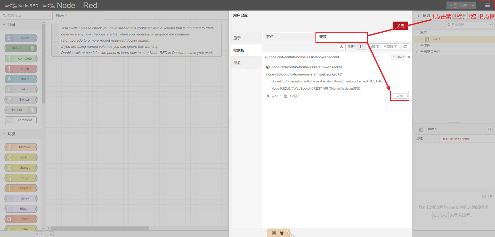
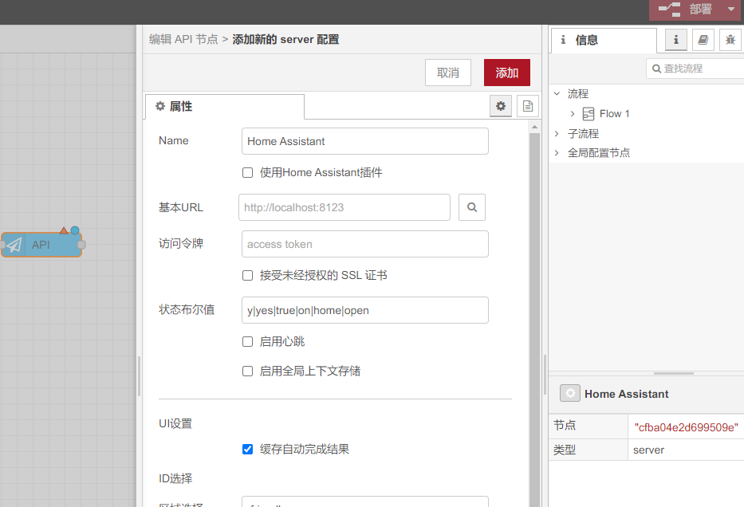

# Homeassistant 极简安装法
通过 Docker 容器运行 Home Assistant Core是最快速的方法，不包含 Supervisor 和 Add-ons，但是可以自己运行docker容器来扩展，安装简单，不依赖特定硬件。
> - 官方安装指南： [Installation - Home Assistant](https://www.home-assistant.io/installation/) 
> - 不同安装方法的说明： [Installation Methods & Community Guides Wiki - Home Assistant](https://www.home-assistant.io/blog/2020/05/26/installation-methods-and-community-guides-wiki/) 
## 1.准备一台windows、Mac、Linux设备

## 2.安装docker

```bash
# 国外环境
wget -qO- get.docker.com | bash
# 中国环境环境
curl -fsSL https://get.docker.com -o get-docker.sh

sh get-docker.sh --mirror=Aliyun
```

## 3.（可选）配置镜像源
目前，国内大部分Docker 镜像源（比如 https://docker.mirrors.ustc.edu.cn）已经无法使用，我们需要使用镜像代理，有两种方案：

1. （更推荐，但更复杂）阿里云容器镜像：使用**[docker-pull-proxy](https://github.com/yaming116/docker-pull-proxy)**等仓库，将docker镜像上传到私有的阿里云容器镜像仓库。
2. （更简单，不建议用于生产）Cloudflare Worker 上运行代理，比如 [ciiii/cloudflare-docker-proxy](https://github.com/ciiiii/cloudflare-docker-proxy)。

镜像配置：将`/etc/docker/daemon.json`中的 "http://mirrors.ustc.edu.cn"自己替换为自己的域名，此方法全局生效，或者针对单个镜像：将`ghcr.io/home-assistant/home-assistant:stable`修改为 `你的域名/ghcr.io/home-assistant/home-assistant:stable` 

```bash
sudo mkdir -p /etc/docker
sudo tee /etc/docker/daemon.json <<-'EOF'
{
  "registry-mirrors": ["http://mirrors.ustc.edu.cn"]
}
EOF
sudo systemctl daemon-reload
sudo systemctl restart docker
```

## 4.部署homeassistant

```bash
# 创建homeassistant文件夹
mkdir ha 
cd ha
# 创建文件docker-compose.yml
touch docker-compose.yml
nano docker-compose.yml # vim docker-compose.yml
```

填写docker-compose.yml：

```yaml
services:
  homeassistant:
    container_name: homeassistant
    image: ghcr.io/home-assistant/home-assistant:stable # 或者用你自己的镜像
    volumes:
      - "./config:/config"
      - "/etc/localtime:/etc/localtime:ro"
      - "/run/dbus:/run/dbus:ro" # 蓝牙设备需要
      # - "./mymusic:/media/mymusic"  # 挂载本地音乐文件夹
    environment:
      - SET_CONTAINER_TIMEZONE=true
      - CONTAINER_TIMEZONE=Asia/Shanghai
      # 如果需要使用国内镜像源，可以取消下面两行的注释，并根据需要修改为其他镜像源
      # - PIP_INDEX_URL=https://pypi.tuna.tsinghua.edu.cn/simple
      # - PIP_TRUSTED_HOST=pypi.tuna.tsinghua.edu.cn
    restart: unless-stopped
    privileged: true
    network_mode: "host"
```

```
# 运行
docker compose up --build -d # -d后台运行
docker compose logs -f # 查看日志 -f 持续监控日志 ctrl + c 可以退出
```

根据你的设备情况，等待一会就可以访问http://localhost:8123了。

## 更高级的自动化解决方案 

---

### node-red的安装和配置

homeassistant的自动化已经很强大了，如果需要更高级的解决方案，可以使用哦个 [node-red](https://nodered.org/)，也可以选择docker安装，docker-compose.yml新增以下内容：

```yaml
services:
  homeassistant:
    # 保持原有内容

# 新增以下内容
  node-red:
    image: nodered/node-red
    container_name: nodered
    environment:
      - TZ=Asia/Shanghai
    ports:
      - "1880:1880"
    volumes:
      - ./node-red-data:/data
    restart: unless-stopped
    depends_on:
      - homeassistant
```
nodered更灵活的安装方式是使用npm安装，参考 [Node-RED](https://nodered.org/#get-started) 。

容器运行之后，通过命令行或者图形界面（http://你的ip:1880/）安装node-red-contrib-home-assistant-websocket，然后进入nodered页面进行配置。

1. 通过命令行安装node-red-contrib-home-assistant-websocket

```bash
docker compose exec node-red bash
npm config set registry https://registry.npm.taobao.org 
npm install node-red-contrib-home-assistant-websocket -y
# ctrl + d 退出
# 重启nodered
docker compose restart node-red

```

2. 登录http://localhost:1880/端口，通过图形界面安装



随便拖入一个ha节点双击进行配置。



### 关于node-red登录界面设置密码

简单来说：

1. 打开node-red-data找到settings、然后修改adminAuth。

2. 由于此密码必须进行加密，不能直接填入明文密码，你需要进入nodered容器中执行以下命令生成加密后的密码:

```bash
node -e "console.log(require('bcryptjs').hashSync(process.argv[1], 8));" your-password-here
```


